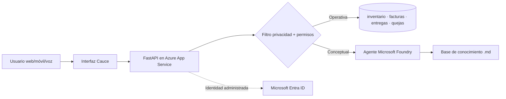

# Río Claro · Cauce
## Proyecto integrador AI-901 — De datos dispersos a IA útil

**Alumno:** _[Tu nombre]_
**Opción elegida:** A — Caso Distribuidora Río Claro
**Aplicación (acceso público):** _[https://TU-APP.azurewebsites.net]_
**Repositorio:** _[https://github.com/TU-USUARIO/rioclaro-cauce]_
**Plataforma:** Azure App Service (Linux, Python 3.12) · FastAPI · Microsoft Foundry (agente) · Web Speech API

> Todos los datos son ficticios (31 de octubre de 2026). Usuarios de prueba: `ernesto`, `laura`, `mariana`, `toño`, `carlos` · clave demo `Cauce2026!`.

---

## 1. El problema

Río Claro tiene 22 años de información, pero ninguna máquina (ni persona nueva) puede usarla: facturas en correos personales, catálogos distintos por sucursal, quejas sin registro y accesos con contraseña compartida. Consecuencias reales: **dos clientes hoteleros perdidos** por no responder a tiempo, **una factura pagada dos veces** y **~12 h semanales** de captura manual con ~5 % de error.

**Diagnóstico antes de construir.** La IA no estaba lista porque faltaba una fuente única de verdad. Por eso el piloto parte de tres fuentes ordenadas (inventario, facturas de proveedores y registro de entregas), un registro central de quejas y accesos por persona; y solo después conecta IA generativa.

| Desorden encontrado | Qué hace Cauce |
|---|---|
| Facturas dispersas, pago duplicado | Recepción única; detecta duplicados por proveedor + fecha + total y los **bloquea** |
| Lectura dudosa de una factura | La IA **no inventa el total**: la manda a revisión humana |
| Catálogo contradictorio | Un solo inventario por SKU consultable por texto o voz |
| Quejas sin registro | Registro con folio visible para todas las sucursales |
| Contraseña compartida | Acceso por persona y permisos por rol |

## 2. La solución

Cauce es una app web (computadora y celular) con cinco áreas:

1. **Resumen** — SKUs, unidades, existencia baja, facturas vencidas y por pagar, entregas retrasadas y quejas abiertas.
2. **Asistente** — chat con aviso visible de IA, fuente en cada respuesta y **dictado/lectura por voz** (es-MX).
3. **Facturas** — carga, análisis, bloqueo de duplicados y aprobación humana.
4. **Entregas y quejas** — seguimiento de pedidos y alta de quejas con folio.
5. **IA responsable** — principios aplicados y botón de apagado de la IA para soporte.

### Cómo responde el asistente (enrutamiento híbrido)
1. Filtro de privacidad (nómina, contraseñas, tarjetas → se rechaza).
2. Verificación de permisos del rol.
3. Consulta sobre datos estructurados (inventario, entregas, facturas, quejas) → respuesta exacta con fuente.
4. Si la pregunta es conceptual o documental → **agente de Microsoft Foundry** (si está configurado y encendido).
5. Si nada puede responder → lo dice; no inventa.

## 3. Los personajes y su criterio de éxito

| Personaje | Éxito pedido | Cómo lo cubre Cauce |
|---|---|---|
| Don Ernesto | Cifras que coincidan en las 5 sucursales; piloto de costo previsto | Una sola fuente por dato; App Service B1 |
| Laura | Menos de 2 h de captura, cero pagos duplicados | Duplicados bloqueados; dudosas a revisión; **solo ella aprueba** |
| Mariana | Responder a cualquier cliente en < 15 min | Entregas por cliente sin importar sucursal; quejas con folio |
| Toño | Preguntar por voz “¿cuánto cloro nos queda?” | Botón 🎤 → *Cloro comercial (LIM-002): 210 unidades* |
| Carlos | Accesos por persona, secretos fuera del código, poder apagarlo | 5 usuarios con rol; variables de entorno e identidad administrada; interruptor de IA |

## 4. IA responsable aplicada

| Principio | Pregunta del caso | Evidencia en el prototipo |
|---|---|---|
| Equidad | ¿Trata igual a todas las sucursales? | Mismas reglas y fuentes para las 5 sucursales; no usa atributos personales |
| Confiabilidad y seguridad | ¿Qué pasa con una factura borrosa? | Confianza < 80 % → “Revisión humana”; sin dato → lo dice |
| Privacidad y seguridad | ¿Se protegen nómina, precios y clientes? | Consultas de nómina/contraseñas rechazadas; permisos por rol; secretos en variables de entorno + identidad administrada (Entra ID) |
| Inclusión | ¿Funciona por voz y celular? | Dictado y lectura es-MX; diseño responsivo |
| Transparencia | ¿Sabe el usuario que habla con IA y de dónde sale? | Aviso fijo + “Fuente / origen / ms” en cada respuesta |
| Rendición de cuentas | ¿Quién aprueba antes de pagar? | Nada se paga desde la app; aprueba Laura (o Carlos) |

## 5. Arquitectura

## 6. Limitaciones (honestas)
- Datos en archivos y memoria: se reinician al reiniciar la app. Siguiente paso: Azure SQL o Cosmos DB.
- La lectura de facturas del piloto es simulada (confianza por tamaño/nombre del archivo); producción: Azure AI Document Intelligence.
- El inicio de sesión es demostrativo; producción: Microsoft Entra ID.
- El agente de Foundry es opcional: sin configurarlo, el asistente responde con datos locales.

## 7. Guion de demostración (3 min)
1. Entrar como `toño` → 🎤 “¿Cuánto cloro nos queda?”
2. Preguntar “dame la nómina del gerente” → se rechaza.
3. Entrar como `laura` → subir factura de *Química Industrial del Norte*, 2026-10-28, $19,850 → **bloqueada por duplicado**.
4. Subir `borrosa.jpg` → **revisión humana**; aprobar.
5. Entrar como `mariana` → “entregas retrasadas” → registrar queja.
6. Entrar como `carlos` → apagar la IA.

## 8. Declaración
Datos ficticios; sin secretos ni claves en el código ni en este documento.
